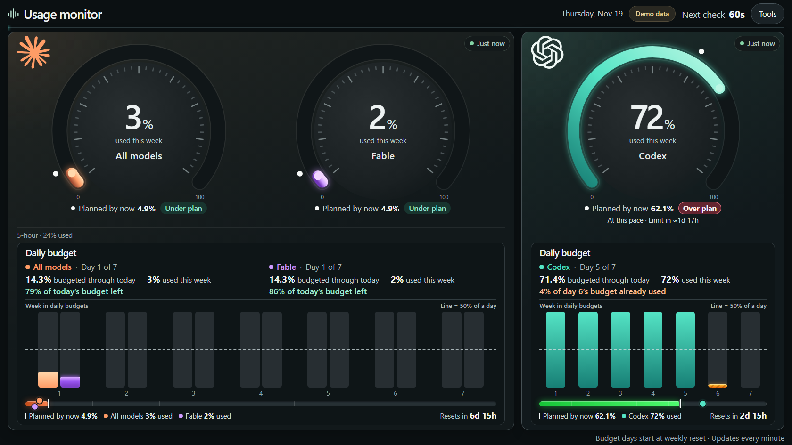

# Usage Monitor for Windows

See your Claude and Codex weekly allowances, how far ahead or behind you are today, and when each budget resets. The gauges, daily bars and reset timeline run on your own PC.

**[Download Usage Monitor 0.1.0 for Windows x64](https://github.com/iKoshelkov/usage-monitor/releases/download/v0.1.0/UsageMonitor-0.1.0-windows-x64.msi)** · [All releases](https://github.com/iKoshelkov/usage-monitor/releases)

## Get started

1. Download the Windows installer and open it. Select **Install**.
2. From Start, open **Usage Monitor**. Select **Open dashboard** to try the demo.
3. In **App settings**, choose your readings. From the dashboard, open **Tools → App settings & updates** to get back.

Runs on Windows 10 or 11 x64. The installer includes Python. The app opens in your browser and serves the dashboard on this PC. You can close the tab and reopen it from Start. **Quit Usage Monitor** in App settings stops its background checks.

## Use your own numbers

| Source | What it shows |
| --- | --- |
| Signed-in Codex CLI | Reads your Codex allowance every five minutes. A weekly gauge requires a weekly window from your account. The figure covers Codex usage on your ChatGPT plan. |
| Claude Code status line | App settings gives you a PowerShell command to start a Claude Code session with usage reporting. Claude Code supplies the overall weekly reading after account activity. Fable requires a separate reading from the source. |
| Manual entry | Enter a percentage and the next local reset time from your account. You can enter Claude All models, Fable, or Codex separately. Manual readings show their age until you update them. |
| Clock exports | Select a folder containing your collector's `claude.json` or `codex.json`. The app reads those files every minute. |

Each clock export has an `observed_at` timestamp and a `windows` list. Each window has a `label`, a numeric `used` percentage from 0 to 100, and an optional `resets_at` timestamp. Use `Weekly` for the overall allowance and `Fable weekly` for the separate Fable allowance. Dates use ISO 8601 with a timezone. Missing readings show a dash.

The app stores settings and readings in **%LOCALAPPDATA%\UsageMonitor**. The Claude integration saves the usage fields from the status line. Codex handles its own sign-in. [Claude Code status-line fields](https://code.claude.com/docs/en/statusline) · [Codex app server](https://developers.openai.com/codex/app-server)

## Updates

The app checks this repository for a newer Windows release on launch if a check is due, then daily. Use **Check for updates** to check immediately. When an update is available, choose **Download update**, quit the app, and open the new installer. Your settings and readings carry over. The public beta installer is unsigned.

Usage Monitor is independent of Anthropic and OpenAI.
